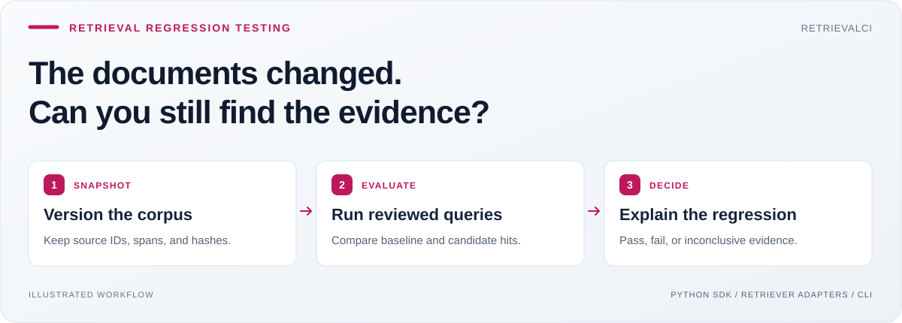
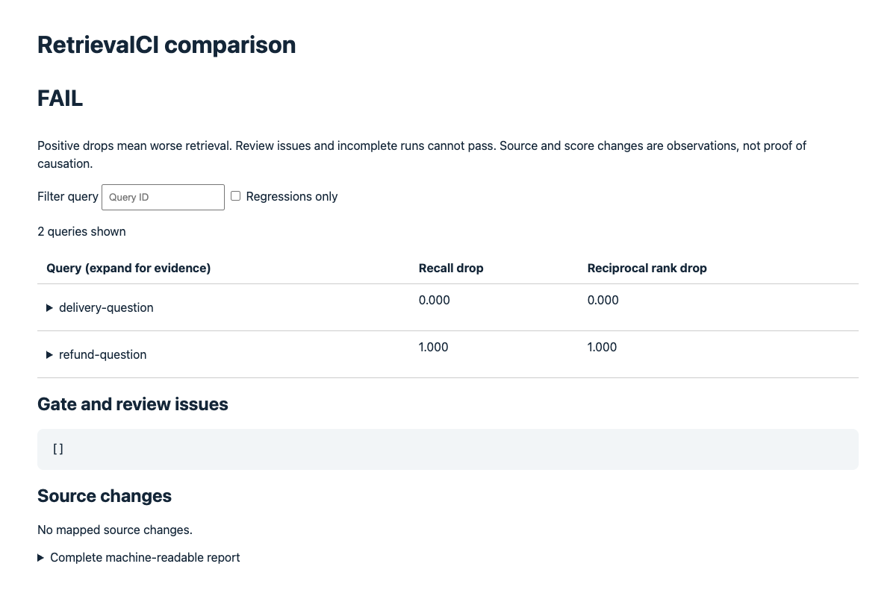
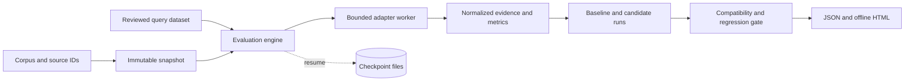

<h1 align="center">RetrievalCI</h1>
<p align="center"><strong>Catch retrieval regressions before they reach your answers.</strong></p>
<p align="center">Compare evidence, ranking and coverage across corpus changes—with a CI result you can inspect.</p>

<p align="center">
  <a href="https://github.com/Balaji91221/retrievalci/actions/workflows/ci.yml"></a>
  <a href="LICENSE"></a>
  
  
</p>
<p align="center">
  <a href="#why-i-built-it">Why</a> · <a href="#quick-start">Quick start</a> · <a href="#usage">Usage</a> · <a href="#architecture">Architecture</a> · <a href="#docs">Docs</a>
</p>



RetrievalCI is a Python library and CLI for engineers maintaining RAG and search systems. It compares a baseline retrieval run with a candidate, shows which queries lost relevant evidence, and separates ranking regressions from labels that became outdated when the corpus changed.

## Why I built it

As an AI engineer, I want to test the evidence pipeline before judging the generated answer. A new document, changed chunking strategy, or retriever update can change what reaches the model. I built RetrievalCI to preserve the inputs, compare each reviewed query, and make incomplete evidence visible instead of reducing every change to an average score.

### The problem → the solution

| When this happens | RetrievalCI helps by |
|---|---|
| A new document displaces the refund policy from the top result | Showing the query's recall and reciprocal-rank drop, with both hit lists |
| A reviewed source is deleted or rewritten | Returning `INCONCLUSIVE` and identifying the evidence that needs review |
| Chunk boundaries change | Mapping retrieved chunks back to stable reviewed paragraph evidence |
| A provider hangs halfway through an evaluation | Bounding attempts and resuming completed query work from a checkpoint |

### What you get

- **Immutable corpus snapshots** with hashes, optional source spans and explicit source identities.
- **Per-query regression gates** for recall@k and reciprocal rank, so unrelated improvements cannot hide a loss.
- **Explicit completeness checks** for reviewed labels, index alignment and provider results.
- **Bounded execution and resume** with process deadlines, retries and immutable checkpoints.
- **Offline evidence reports** with query search, regression filtering, source diffs and expandable records.

## Quick start

Requires Python 3.10+. The runtime uses the standard library; the lexical demo needs no model, database or account.

### Install the package

```bash
python -m pip install retrievalci
retrievalci --help
```

Create an immutable snapshot with the installed CLI, without cloning anything:

```bash
retrieval_demo="$(mktemp -d)"
printf '%s\n' 'Refunds are available within 30 days.' > "$retrieval_demo/refunds.md"
retrievalci snapshot "$retrieval_demo" --store "$retrieval_demo/artifacts"
```

The command prints a snapshot ID and an evidence manifest. This captures inputs; reviewed queries and comparable baseline/candidate runs supply the regression gate. These shell snippets use bash/zsh.

### Run the complete source demo

The repository contains the four-case demo below, tests and provider fixtures. These are included in the source distribution; the wheel installs the library and CLI.

```bash
git clone https://github.com/Balaji91221/retrievalci.git
cd retrievalci
python3 -m venv .venv
source .venv/bin/activate
python -m pip install .
python examples/demo.py
```

On Windows, activate with `.venv\Scripts\activate`. The demo writes reports to `demo-output/` and prints these expected outcomes:

```text
baseline: PASS (expected)
ranking-regression: FAIL (expected)
deleted-gold: INCONCLUSIVE (expected)
stale-gold: INCONCLUSIVE (expected)
```

Open `demo-output/ranking-regression.html` in your browser. The demo command succeeds when all four expected outcomes match; the `compare` CLI uses exit 0 for pass, 1 for regression and 2 for an inconclusive check.



*An offline report from the authored local fixture. It demonstrates the gate, not production search quality.*

## Usage

### Compare runs from Python

Save this as `check_retrieval.py` in the repository root and run `python check_retrieval.py` after installation. The entry-point guard is required because adapters run in spawned processes.

```python
import json
from pathlib import Path
from retrievalci import LexicalRetriever, QueryDataset, Snapshot, compare, evaluate


def main():
    fixtures = Path("examples/fixtures")
    dataset = QueryDataset.load(fixtures / "queries.json")

    def run(name):
        corpus = json.loads((fixtures / f"{name}.json").read_text())
        return evaluate(LexicalRetriever(), dataset, Snapshot.from_corpus(corpus), k=1)

    report = compare(run("baseline"), run("ranking-regression"))
    print(report["verdict"])  # FAIL: the fixture intentionally worsens ranking.


if __name__ == "__main__":
    main()
```

### Connect your retriever

Implement the small [retriever adapter contract](docs/usage.md#sdk), or connect an existing service using `--provider-url`. The HTTP adapter sends the query, k and snapshot ID; your service returns ordered evidence IDs plus an index-completeness declaration. [HTTP contract and fixture →](docs/usage.md#http-provider-integration)

```bash
retrievalci snapshot examples/fixtures/baseline.json --store .retrievalci
# Use the snapshot ID printed above:
retrievalci run --dataset examples/fixtures/queries.json \
  --snapshot SNAPSHOT_ID --k 1 --store .retrievalci
```

The bundled lexical adapter is a deterministic baseline. Your embedding or vector-store adapter owns its dependencies and credentials. RetrievalCI has **no MCP server**; integrate through Python, the CLI, or an HTTP retriever endpoint.

### Use it as a CI gate

```bash
retrievalci compare --baseline BASELINE_RUN_ID --candidate CANDIDATE_RUN_ID \
  --store .retrievalci --json comparison.json --html comparison.html
```

Use actual run IDs from evaluations of the same reviewed dataset, k and evidence identity. Adapter/configuration changes can vary. An incomplete run cannot pass; changed gold evidence requires review before a meaningful comparison. [Full evaluation and checkpoint guide →](docs/usage.md)

## Architecture



| Component | Responsibility |
|---|---|
| [models.py](src/retrievalci/models.py), [ingest.py](src/retrievalci/ingest.py) | Define reviewed evidence, corpus identity and chunk/source mapping |
| [engine.py](src/retrievalci/engine.py) | Normalize retrieval results, score queries and compare compatible runs |
| [execution.py](src/retrievalci/execution.py) | Own worker deadlines, retries and checkpoint inputs |
| [store.py](src/retrievalci/store.py) | Persist immutable snapshots and runs by content hash |
| [providers.py](src/retrievalci/providers.py), [report.py](src/retrievalci/report.py) | Connect HTTP retrievers and render inspectable offline evidence |

[Read the HLD, LLD, contracts and design tradeoffs →](docs/architecture.md)

### Deliberate boundaries

RetrievalCI evaluates retrieval evidence, not generated-answer quality. Gold labels require human review; provider completeness is a declaration, not independent proof. Process deadlines contain hangs but do not sandbox malicious adapters. PDF/OCR ingestion, hosted dashboards and managed embedding providers are outside this release.

## Docs

| Learn or build | Start here |
|---|---|
| Ingest, evaluate, compare, resume and connect providers | [Usage guide](docs/usage.md) |
| Understand worker, storage and scoring contracts | [Architecture](docs/architecture.md) |
| Inspect synthetic review data | [Held-out fixtures](examples/heldout/README.md) |
| Check implemented scope and evidence | [Implementation status](IMPLEMENTATION_STATUS.md) |
| Contribute or report a vulnerability | [Contributing](CONTRIBUTING.md) · [Security](SECURITY.md) |

Run the source checks from the repository root:

```bash
PYTHONPATH=src python -m unittest discover -s tests -v
```

The local source and installed-wheel suites passed 37 tests. The suite includes a controlled loopback HTTP provider; current hosted results are in the CI badge above. Synthetic fixtures are not a real-user benchmark.

MIT licensed. See [LICENSE](LICENSE) and [CHANGELOG.md](CHANGELOG.md). Version 0.2.0 is a development release. Independent pilots and production validation remain separate steps.

---

Explore more of my work: [latest open-source tools](https://github.com/Balaji91221#latest-open-source-tools) · [recent projects](https://github.com/Balaji91221#recent-work).
