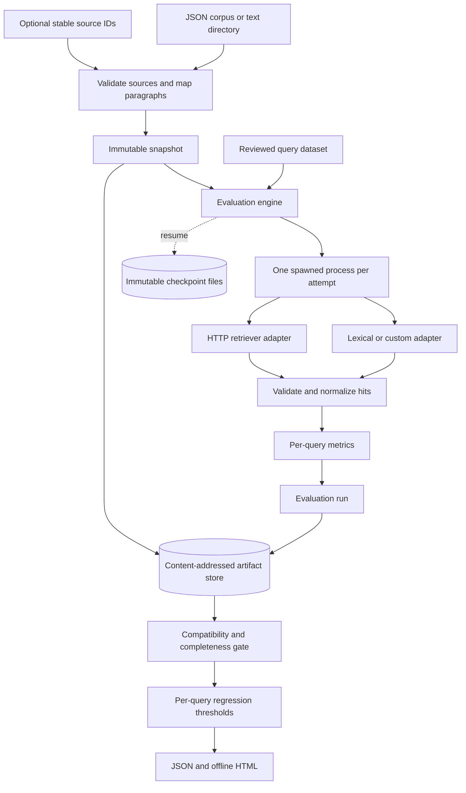

# RetrievalCI architecture

[README](../README.md) · [Usage](usage.md) · [Implementation status](../IMPLEMENTATION_STATUS.md)

This is the implemented 0.2.0 design. This document follows the actual models, worker boundary and artifact storage.

## Goal and system boundary

RetrievalCI answers **did this candidate retrieval system lose reviewed evidence compared with its baseline?** It checks whether both runs are complete and comparable before applying per-query metric thresholds. A changed or deleted gold source requires review; it is not automatically counted as a ranking miss.

The deployment is a local Python SDK and CLI. It reads JSON corpora or UTF-8 Markdown/text directories, invokes trusted retriever adapters in bounded worker processes, stores immutable JSON artifacts and renders offline HTML. An optional HTTP adapter connects an existing retriever service. No MCP server, hosted dashboard, managed vector database or answer-generation service is implemented.

## High-level design



The engine owns correctness of evaluation and comparison. Execution owns deadlines and resource cleanup. Adapters own retrieval and index declarations. The store owns durable artifact identity; it does not decide what constitutes a regression.

## Low-level responsibilities

| Module | Owner of | Main contracts |
|---|---|---|
| [models.py](../src/retrievalci/models.py) | Domain shapes, hashes, validation and metrics | `Snapshot`, `QueryDataset`, `EvaluationRun`, `Hit` |
| [ingest.py](../src/retrievalci/ingest.py) | Source IDs, paragraph spans and retrieval chunk mapping | `ingest_directory(...) -> Snapshot` |
| [engine.py](../src/retrievalci/engine.py) | Orchestration, hit normalization, scoring and comparison | `RetrieverAdapter`, `evaluate(...)`, `compare(...)` |
| [execution.py](../src/retrievalci/execution.py) | Worker lifecycle, retry policy and resume inputs | `ExecutionPolicy`, `execute(...)`, `ResumeJournal` |
| [providers.py](../src/retrievalci/providers.py) | Completeness envelope and explicit HTTP integration | `RetrievalBatch`, `HTTPRetriever` |
| [store.py](../src/retrievalci/store.py) | Atomic content-addressed storage and integrity checks | `SnapshotStore` |
| [report.py](../src/retrievalci/report.py) | Offline interactive explanation of comparisons | `render_html(report)` |
| [cli.py](../src/retrievalci/cli.py) | Commands, dependency selection and exit mapping | `snapshot`, `run`, `compare` |

### Public contracts

```python
evaluate(
    retriever, dataset, snapshot, k=3, *, policy=None,
    checkpoint_dir=None, resume=False, max_queries=None,
    require_index_attestation=True,
) -> EvaluationRun

compare(baseline, candidate, max_recall_drop=0.0, max_rr_drop=0.0) -> dict

retriever.retrieve(query, k, snapshot) -> RetrievalBatch
```

A retriever has `name` and `version`, may expose JSON-serializable `configuration`, and must be a top-level pickleable object. The worker uses multiprocessing `spawn`, so calling scripts need an `if __name__ == "__main__":` guard. `RetrievalBatch` includes ordered hits, `snapshot_id`, `index_complete` and `index_id`.

## Evidence and identity

A snapshot contains document IDs/text, normalized retrieval configuration and optional source/span/chunk mappings. Canonical serialization produces its SHA-256 ID. A document's content hash anchors a reviewed label to exact text. Query datasets have their own versioned payload and content identity.

Directory ingestion supports UTF-8 `.md` and `.txt`, with a default 2 MB bound per file. An explicit relative-path-to-source-ID map allows a file rename to retain identity. Each paragraph becomes `source-id#paragraph:N` with Unicode-character offsets. Retrieval chunks can group several paragraphs while gold labels continue to reference paragraph evidence.

This is a deliberately limited identity model. Editing, inserting or reordering paragraphs can invalidate labels; the system does not infer semantic correspondence across arbitrary rewrites. A configured source ID preserves a reviewed mapping only where the evidence hashes still agree.

### Hit normalization and metrics

The engine rejects wrong snapshot IDs, incomplete indexes, missing index identities, unknown or duplicate raw hit IDs, non-finite scores and more than k raw hits. Mapped chunks expand into evidence IDs, retaining the chunk's original rank. Overlapping evidence is counted once, at its earliest rank.

- **Recall@k:** fraction of reviewed gold evidence units covered within the first k retrieved units.
- **Reciprocal rank:** inverse rank of the first relevant retrieved unit, or zero.
- **Coverage:** scored queries relative to non-excluded queries; partial means remain diagnostic.

The k budget counts raw chunks/documents. Two gold paragraphs inside the first retrieved chunk both have rank 1. Thresholds apply to every scored query, so improvements elsewhere do not cancel a regression.

## One evaluation, end to end

1. The caller loads a reviewed dataset and immutable snapshot, then selects an adapter and execution policy.
2. `evaluate` revalidates inputs and forms an input signature containing snapshot, dataset, k, adapter configuration and policy. A resume journal must match that signature exactly.
3. Each active query checks its gold IDs and hashes against the snapshot. Stale/deleted evidence becomes `review_required` before retrieval.
4. A new worker runs one adapter attempt. The parent bounds the wait, records outcome/latency and cleans up the process. Only transient failures retry with capped exponential backoff.
5. The engine validates successful batches, normalizes chunk/evidence identity and calculates metrics. Errors and pending work remain explicit in the result.
6. The run records inputs, evidence manifest, attempts, query results and a completeness summary. The caller can persist it through `SnapshotStore`.
7. `compare` checks compatible dataset identity, k, evidence-identity version and complete runs before deciding PASS/FAIL. It also emits source changes and per-query deltas for the report.

### States and verdicts

| Query status | Why it occurs | Comparison consequence |
|---|---|---|
| `ok` | Reviewed evidence and a valid complete retrieval result | Metrics eligible for comparison |
| `review_required` | Unreviewed labels, deleted gold or changed gold hash | Inconclusive |
| `error` | Provider failure, timeout or invalid batch | Inconclusive |
| `pending` | Evaluation intentionally stopped before this query | Inconclusive |
| `excluded` | Reviewed unanswerable query, outside recall metrics | Excluded; an entirely excluded suite cannot pass |

`compare` returns `INCONCLUSIVE` for incompatible/incomplete inputs, `FAIL` for a per-query drop above threshold, and otherwise `PASS`. A complete `run` can still have poor recall; completeness is not the regression verdict.

## Worker and provider boundary

Each attempt starts fresh. `ExecutionPolicy` bounds attempts and backoff; execution records distinguish transient connection/timeouts from configuration or contract errors. On POSIX, workers own a process group cleaned up on exit/timeout. Windows terminates the worker, without a guarantee of descendant-tree containment.

Workers contain accidental hangs, not malicious Python code. Adapters are trusted code and worker communication uses pickle. This is not a multi-tenant sandbox or an adversarial attestation system.

`HTTPRetriever` posts the query, k and snapshot ID to an explicit endpoint. It does not upload the corpus automatically. Non-loopback endpoints require HTTPS; redirects and ambient proxies are disabled, credentials cannot be embedded in URLs, and response bodies are bounded. An optional token is read from its named environment variable in the worker. The remote service owns indexing, embedding dependencies, credentials and its completeness declaration.

## Storage, resume and concurrency

`SnapshotStore` stores canonical JSON under `snapshots/` and `runs/`, using content hashes as filenames. Writes flush a temporary file and link it into place without replacing an existing artifact. A concurrent existing artifact must have identical bytes. Reads validate hashes and structure.

A resume journal owns one input signature in `inputs/`, with immutable per-query records in `results/`. Resume reuses completed non-error/non-pending results; failed and interrupted queries rerun. Changed inputs, corrupted records or conflicting completed results are rejected. An interrupted in-flight attempt restarts from its beginning; it is not resumed halfway through an HTTP request.

The content-addressed file model avoids a database service and preserves old baseline artifacts. It is not distributed scheduling, garbage collection or access control. Preserve original artifacts when changing schema/readers; readers cannot infer trust from a hash if an attacker replaces both the data and its expected identifier.

## LLM boundary and design tradeoffs

No LLM is needed for ingestion, evaluation, comparison or reporting. RetrievalCI measures evidence selection before answer generation. It does not generate relevance labels, score answers with an LLM judge, or silently update gold hashes to make a test pass. An external retriever may use embeddings or a model; those are behind the adapter contract.

| Choice | Benefit | Tradeoff |
|---|---|---|
| Reviewed gold IDs and hashes | Separates retrieval regression from evidence drift | Labels need maintenance as content changes |
| Per-query gates | Prevents an average from hiding a damaged query | A threshold policy must reflect intended changes |
| Fresh processes per attempt | Hard deadlines and repeatable adapter start state | Startup/serialization overhead; pickleable adapters required |
| Content-addressed files | Transparent local artifacts and immutable baselines | No hosted collaboration or database query layer |
| Explicit index declaration | Detects declared partial/mismatched indexes | Cannot independently prove a remote index is complete |

The domain models, execution, persistence and presentation have separate reasons to change. A new retriever implements the small structural protocol without changing metric rules; every adapter must preserve ordered mapped IDs and completeness semantics. Legacy list-returning adapters require explicit SDK opt-in and are labelled assumed-complete, rather than weakening the default contract. CLI composition selects a concrete adapter; the evaluation algorithm consumes the contract.

Other changes intentionally touch the owner of the behavior: a new metric belongs in domain scoring and comparison tests; a new ingestion format must preserve evidence identity rules. Additional abstraction layers are not required to add these features.

## Validation and operations

The [tests](../tests) cover hand-calculated metrics, chunk mapping, review gates, deadlines, retries, corrupted artifacts, checkpoint inputs and controlled HTTP contracts. The [demo](../examples/demo.py) exercises pass, ranking regression, deleted gold and stale gold. The [held-out fixture set](../examples/heldout/README.md) is synthetic and separate from the quick-start corpus.

Use [IMPLEMENTATION_STATUS.md](../IMPLEMENTATION_STATUS.md) for recorded local evidence and the [workflow](https://github.com/Balaji91221/retrievalci/actions/workflows/ci.yml) for current hosted results. Reports and snapshots include corpus text and query evidence; review them before sharing. This local tool does not provide retention automation, multi-tenancy or production-data access controls.
